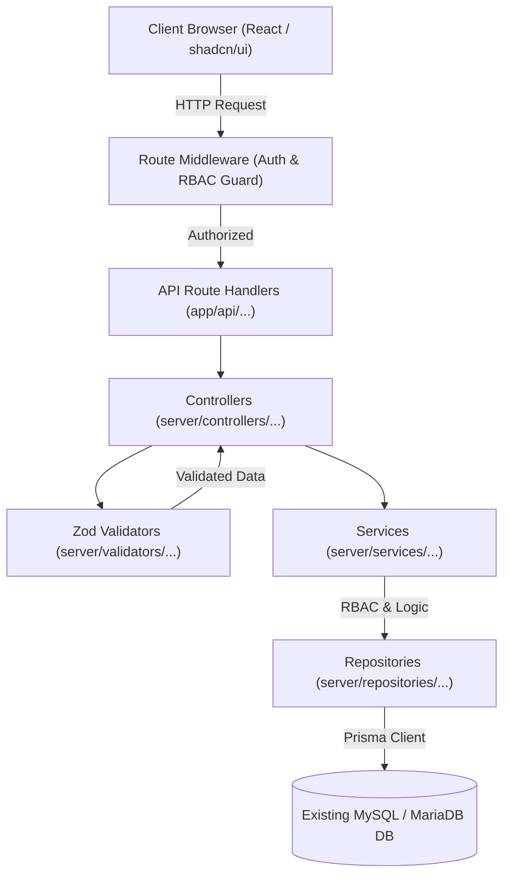

# Zprofile Architecture Documentation

## System Overview

Zprofile Node is an enterprise-grade full-stack platform built with Next.js (App Router), Tailwind CSS, shadcn/ui, and Prisma ORM, providing a modern talent management and profile building experience while connecting directly to the existing MySQL / WordPress database.

## Data Model & Legacy Table Mapping

| WordPress Table | Prisma Model | Purpose in Zprofile Node |
| :--- | :--- | :--- |
| `wp_users` | `wp_users` | Core user accounts, login credentials, emails. |
| `wp_usermeta` | `wp_usermeta` | Roles (`wp_capabilities`), designations, display preferences. |
| `wp_posts` | `wp_posts` | Profiles (`post_type = 'profile-builder'`) and clients (`post_type = 'client'`). |
| `wp_postmeta` | `wp_postmeta` | Profile details (skills, bio, experience, status history). |
| `wp_options` | `wp_options` | Global system configurations and legacy option bags. |

## Role-Based Access Control (RBAC)

1. **Administrator**:
   - Access to all profiles, clients, and admin settings.
   - Can approve profiles (`is_ready`), reject, or request changes.
2. **Manager**:
   - Reviewer role; can review all profiles, request changes, and view analytics.
3. **Engineer**:
   - Self-contained access; can only create, view, and edit their **own** profile (`authorId = user.id`).
   - Can submit draft profile for review (`in_review`).
   - Can only view clients created by themselves.
4. **Partner**:
   - External contractor; identical data isolation constraints to Engineer.
